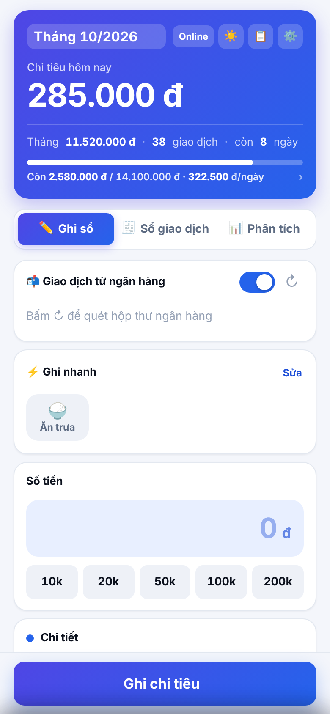
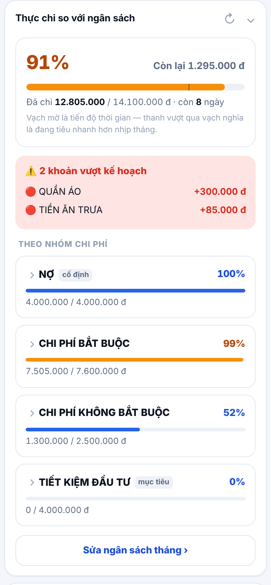
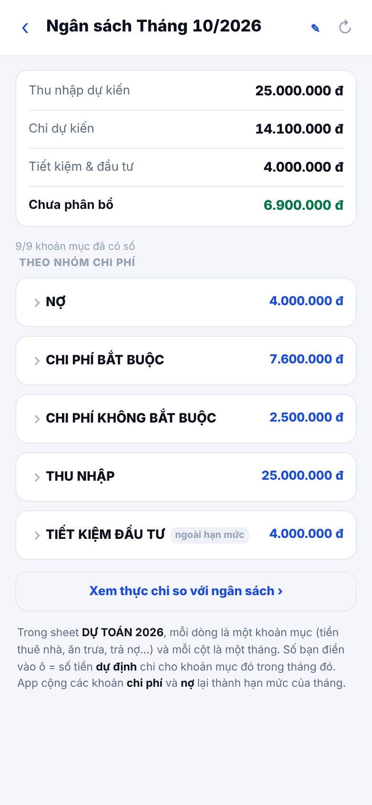

# Ví Chi Tiêu — an offline-first expense tracker on top of a live Google Sheet

A personal-finance PWA for iPhone that reads and writes a Google Sheet I had already
been using for years — without reformatting it, and without breaking the formula
tables it feeds.

The interesting constraint is not "build a CRUD app". It is: **the database is a
spreadsheet somebody already depends on, its layout is fixed, and the formulas must
keep working after every write.**

| | |
|---|---|
| **Frontend** | Single self-contained `index.html` — 6,601 lines (4,957 JS / 1,153 CSS), 219 functions, no build step, no framework |
| **Backend** | Google Apps Script — 4,335 lines, 128 functions, 25 API actions |
| **Hosting** | GitHub Pages (static shell) → Apps Script Web App (data) |
| **Data** | Google Sheets: one sheet per month + a `LIST` taxonomy sheet + a `DỰ TOÁN` budget sheet |
| **UI** | Vietnamese / English, 152 translation keys, installed to the iOS home screen as a PWA |

<p align="center">
  
  
  
</p>

<sub>Screenshots use synthetic demo data served by the mock backend in `demo/`, not real figures.</sub>

---

## Why this was not straightforward

### 1. The sheet cannot be restructured

Transactions live in columns `C:H`. Columns `K` through `BK` hold formula tables that
reference those rows by position. That rules out the obvious implementation of almost
every operation:

| Obvious approach | Why it breaks | What the code does |
|---|---|---|
| `sheet.deleteRow(n)` to delete | Shifts every downstream formula reference | Copy the tail block up one row, then `clearContent()` on the last row |
| Add a column for metadata (sync state, source id) | Pushes the formula tables sideways | Keep all app state in `PropertiesService`, keyed by `(sheet, date, amount)` |
| `appendRow()` | Appends past the formula range | Find the real last row by scanning `C:H`, then `ensureRows_()` before writing |
| Write cell by cell | 6 API calls per transaction, slow over mobile data | One `setValues()` of a `1 × 6` range |

The same rule shows up again in the budget sheet: row 59 is both a user-editable item
row *and* a cell holding `=716562+598952+...`. Writing a plain number there would
silently destroy the formula, and the app would report success. `setPlanAmounts`
therefore reads `getFormulas()` alongside `getValues()` and restores any formula in a
row the user did not actually touch:

```javascript
const out = vals.map((row, i) => [
  (!touched[i + 1] && fx[i][0]) ? fx[i][0] : row[0]
]);
```

### 2. Two sheets spell the same category differently

The taxonomy sheet has `CHÍ PHI BẮT BUỘC`; the budget sheet has `CHI PHÍ BẮT BUỘC`.
Elsewhere, `TIẾT KIỆM & ĐẦU TƯ` vs `TIẾT KIỆM ĐẦU TƯ`. These are years-old human typos
in a sheet I did not want to "fix" and risk breaking.

Both sides reconcile through the same diacritic-stripping slug, implemented identically
in Apps Script (`slug_`) and in the browser (`slugVi`):

```javascript
String(x).normalize('NFD').replace(/[̀-ͯ]/g, '')
         .replace(/[đĐ]/g, 'd')
         .toLowerCase().replace(/[^a-z0-9]/g, '');
```

The `[đĐ]` case matters: `đ` has no combining form, so NFD leaves it untouched and a
naive implementation silently mismatches every category containing it.

### 3. Moving a transaction between months must not lose it

Some costs are paid on the last day of a month but belong to the next one's budget.
`moveExpense` writes to the destination sheet and `flush()`es **before** clearing the
source row. The ordering is deliberate: if the script dies mid-operation, the failure
mode is a visible duplicate the user can delete — never a vanished transaction.

### 4. Bank email parsing has to be idempotent

Apps Script scans Gmail for bank notifications and offers them as pre-filled entries.
Because the scan reruns on every refresh, the same email must never produce a second
row. Identity is the Gmail message id; state (`done` / `skipped`) lives in
`PropertiesService` with an undo path, since a misparsed email that is silently
swallowed is worse than one shown twice.

---

## Architecture

```
iPhone (PWA, home screen)
   │
   │  GET  — reads, cached in a service worker shell
   │  POST — writes (text/plain; Apps Script rejects CORS preflight)
   ▼
GitHub Pages ──────► Apps Script Web App ──────► Google Sheets
  index.html            25 routed actions          T10/2026, T11/2026, …
  sw.js                 CacheService (5 min)       LIST (taxonomy)
  manifest                LockService               DỰ TOÁN 2026 (budget)
                          PropertiesService
                                │
                                └──► Gmail (bank notifications)
                                └──► MailApp (budget alerts)
```

**Why the frontend moved off Apps Script's own `HtmlService`.** Serving the UI from
Apps Script meant every cold start paid the script's boot time before a single pixel
rendered, and the page could not be cached by a service worker. Splitting the static
shell onto GitHub Pages made the app open instantly and work offline; the cost is CORS,
which is why writes go out as `Content-Type: text/plain` — anything else triggers a
preflight that Apps Script does not answer.

**Caching and its one hard lesson.** The backend caches reads for 5 minutes via
`CacheService`, invalidated explicitly whenever the app writes. That was wrong in a way
that took a user report to find: the cache only knew about writes *made through the
app*. Editing the sheet directly in Google Sheets changed nothing the cache could see,
so the refresh button dutifully re-fetched and received the same stale payload. Every
read action now accepts a `fresh` flag that bypasses the cache, and the refresh button
sets it.

**One decision point per rule.** The rule for "which categories are exempt from budget
alerts" is evaluated in four places — the in-app badge, the save-time toast, the
tracking card, and the nightly email. It is implemented once on each side
(`alertSkipped_` / `isFixed`) reading the same server-held list, because three
independent re-derivations is three chances for the email and the screen to disagree.

---

## Features

- **Fast entry** — amount-first keypad, quick-amount chips, user-defined shortcuts with emoji
- **Bank email import** — parses notifications from Vietcombank, Cake and Shopee into pre-filled entries, with skip/restore/purge
- **Budget planning** — reads and writes the yearly budget sheet, creates a new month's column, shows income − spending − savings so an unbalanced plan is visible while it is being made rather than at month end
- **Actual vs budget** — per-category progress against plan, pace indicator against elapsed days
- **Threshold alerts** — configurable percentage (default 80%), in-app badge, save-time toast, and a nightly email digest via a time-driven trigger
- **Fixed-cost exemption** — rent, debt repayment and savings targets are excluded from alerts, because hitting 100% of a fixed cost is the plan working, not a problem; over-plan deviation still surfaces as neutral information
- **Cross-month move** — reassign a transaction's booking month, preserving the real spend date in the memo
- **Offline** — service-worker shell with stale-while-revalidate; API calls are never cached
- **Face ID** — WebAuthn with `residentKey: 'discouraged'` and `transports: ['internal']`, PIN as fallback, PIN required on every login by design
- **Bilingual** — Vietnamese / English, switchable at runtime

---

## Testing

Apps Script cannot be unit-tested in place, so the project carries two harnesses:

- **`demo/server.js`** — a mock Apps Script endpoint serving synthetic fixtures. The real
  `index.html` runs against it unmodified apart from one URL, which is how every screenshot
  in this README was produced.
- **Playwright scripts** — drive the real UI through the mock: unlock, record, fold/unfold,
  change language, move a transaction between months, toggle alert exemptions. They assert on
  measured geometry, not on the absence of exceptions — a collapsed block is checked to be
  exactly `0px` tall, because the two worst UI bugs in this project were silent:

  - A CSS class name (`.head`) collided with an existing rule and collapsed every progress
    bar to zero width. No error anywhere.
  - A new function named `toggleDay` was silently shadowed by an existing one defined later
    in the file. The button simply did nothing.

  Both were found by measuring the DOM, not by reading the code.

Backend logic that does not need a spreadsheet — row shifting, formula preservation,
date clamping, the alert scanner — is exercised against fake `Sheet` objects in plain Node.

---

## Running it yourself

1. Copy `backend/Code.gs` into a new Apps Script project bound to your spreadsheet.
2. Fill in `CONFIG.SPREADSHEET_ID`, `CONFIG.APP_PIN` and `CONFIG.API_TOKEN`.
3. Deploy as a Web App (*Execute as: me*, *Who has access: anyone*), then run
   `installAlertTrigger()` once for the nightly digest.
4. Set `EXEC_URL` and `API_TOKEN` at the top of `index.html` to match, and publish the
   repository root with GitHub Pages.
5. Bump `CACHE_VERSION` in `sw.js` and `BUILD` in `index.html` together on every change,
   or the service worker will keep serving the old shell.

To explore the UI without any of that:

```bash
node demo/server.js      # → http://127.0.0.1:8811/index.html, PIN 123456
```

The mock serves the repository's own `index.html` and rewrites `EXEC_URL` at request time,
so the demo always runs the real frontend rather than a drifting copy of it.

---

## Known limitations

Listed because they are real, not resolved:

- **The API token is not a secret.** It ships in `index.html`, which any browser can read.
  It raises the bar against drive-by requests and nothing more. The actual access control
  is the PIN plus a server-side lockout after 5 failures.
- **Reads pass the PIN as a URL query parameter.** It ends up in Apps Script's execution
  logs. Moving reads to POST is the fix; it has not been done yet.
- **The failure counter is global, not per-device.** One wrong-PIN streak locks every client
  out for 15 minutes. Correct for a single-user app, wrong for anything beyond it.
- **Single user by construction.** One spreadsheet, one PIN, one Apps Script quota. There is
  no multi-tenancy and adding it would mean leaving Apps Script.
- **~60 toast and error strings are still Vietnamese-only** in English mode; the 152
  translated keys cover the interface chrome, not every runtime message.
- **Apps Script quotas apply** — 6 minutes per execution, daily email caps. Fine at this
  scale; the first real wall if the dataset grew.

---

## License

MIT — see [LICENSE](LICENSE).
